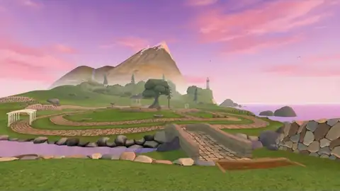

# Project Flowerbed

[](https://github.com/meta-quest/project-flowerbed/actions/workflows/ci.yml)
[](LICENSE)

Grow a garden on a quiet island: a meditative WebXR virtual reality gardening
game for Meta Quest, built with the [Immersive Web SDK (IWSDK)](https://iwsdk.dev).



<p align="center">
  <a href="https://iwsdk.dev"></a>
  &nbsp;
  <a href="https://github.com/facebook/immersive-web-sdk"></a>
  &nbsp;
  <a href="https://meta-quest.github.io/project-flowerbed/"></a>
</p>

> [!NOTE]
> **This is an IWSDK showcase.** Showcases are complete, open-source apps that
> show how IWSDK features work together in a real product, not isolated
> snippets. Read the code to see how it is done, or fork it as the starting
> point for your own VR experience.
>
> **Start your own IWSDK app in one command:** `npm create @iwsdk@latest`

## Try it

**Live demo:** <https://meta-quest.github.io/project-flowerbed/>

Open the link in Meta Quest Browser and select **Start gardening**. On a
desktop browser without a headset, the same page starts the IWER emulator (an
emulated Quest that runs in the browser) and you play with mouse and keyboard.
On a desktop, **Send to my headset** opens the page in Quest Browser on your
headset.

| Device                  | Browser                                            | Notes                                         |
| ----------------------- | -------------------------------------------------- | --------------------------------------------- |
| Meta Quest 3 / 3S / Pro | Meta Quest Browser                                 | Hands or controllers; tuned on Quest 3        |
| Desktop                 | A desktop browser with WebGL2 (tested in Chromium) | Mouse and keyboard, through the IWER emulator |

Project Flowerbed was first released by Meta in 2022, built on Three.js and
ECSY. This version rebuilds it on IWSDK with the original island, plants,
fauna, and sounds; the 2022 code remains in this repository's Git history.

## What it demonstrates

| Capability                                                                                 | Where to look                                                                        |
| ------------------------------------------------------------------------------------------ | ------------------------------------------------------------------------------------ |
| One set of tools for tracked hands and controllers, with rigged glove hands and grip poses | `src/world/hands-system.ts`, `src/core/hands.ts`, `scripts/glove-rerig/`             |
| Large gardens of growing plants: instanced, level-of-detail meshes driven by springs       | `src/gardening/plant-meshes.ts`, `src/gardening/plant-system.ts`                     |
| IWSDK's built-in, worker-threaded locomotion, with thumb microgestures for hands           | `src/world/teleport-system.ts`, `src/core/locomotion-holds.ts`                       |
| Spatial UI in UIKitML: a radial tool dial, a wrist seedbox, settings, tutorial             | `public/ui/*.uikitml`, `src/ui/`                                                     |
| An in-world camera with a live viewfinder, printed photos, easels, and an album            | `src/camera/`                                                                        |
| Morning, sunset, and night lighting, water shaders, fireflies                              | `src/world/time-of-day-system.ts`, `src/world/materials.ts`                          |
| Ambient life and positional audio: fish, ducks, seagulls, butterflies                      | `src/world/fauna-system.ts`, `src/world/ambience-system.ts`, `src/core/audio.ts`     |
| A steady 72 fps on Quest 3 at 1.25× resolution: merged static meshes, prop instancing      | `src/world/island-system.ts`, `src/world/prop-batch-system.ts`, `src/index.ts`       |
| Full desktop play by driving the emulated headset from mouse and keyboard                  | `src/desktop/`                                                                       |
| Several saved gardens, goals with unlockable finishes, and weekly ribbons                  | `src/core/storage.ts`, `src/gardening/garden-system.ts`, `src/gardening/progress.ts` |

## How it plays

Pick a tool from the dial, then use it with the right hand. There are six tools:
Explore, Seeds (32 flowers and trees on four seedbox pages), Water, Remove,
Camera, and Settings.

| Action             | Hands                                                                  | Controllers                                                                         | Desktop                                                                                         |
| ------------------ | ---------------------------------------------------------------------- | ----------------------------------------------------------------------------------- | ----------------------------------------------------------------------------------------------- |
| Open the tool dial | Turn the inside of your left wrist toward you, tap **Tools**           | Right **A**                                                                         | **F**, or **1**–**5** for a tool                                                                |
| Teleport           | Swipe your right thumb forward along your index finger, tap to go      | Right stick forward or back, release to go                                          | Hold **Space**, release to go                                                                   |
| Glide and turn     | Swipe your right thumb left or right to snap turn                      | Left stick glides, right stick left/right turns                                     | **WASD** glides, arrow keys turn                                                                |
| Plant              | Pinch a packet in the seedbox, aim, pinch to plant                     | Point at a packet and pull the trigger; aim, then pull and release                  | Right mouse raises the seedbox; left mouse picks and plants                                     |
| Turn seed pages    | Swipe your left thumb left or right                                    | Left **X** / **Y**                                                                  | **E** / **Q**                                                                                   |
| Water              | Pinch and hold to pour                                                 | Hold the trigger                                                                    | Hold the left mouse button                                                                      |
| Remove a plant     | Point, pinch and hold until the ring fills; **Undo** brings it back    | Point, hold the trigger until the ring fills; **B** undoes                          | Hold the left mouse button                                                                      |
| Take a photo       | Pinch to shoot; pinch the print with your left hand, drop it on a tile | Trigger shoots, **X** / **Y** zoom; left trigger grabs the print, drop it on a tile | Left mouse shoots, wheel zooms; **E** takes the print, then **E** keeps it or **Q** discards it |

While a hand holds a tool's prop (the watering can, a seed packet, the camera,
the seedbox), it grips it in a fixed pose, as a controller does, and a pinch
works the tool. Photos are kept or discarded by dropping the print on the
**Keep** or **Discard** tile that appears beside it, so the hand holding the
camera never has to press anything.

Gardens save automatically; click the left stick to save at once. A short
tutorial runs on first launch, and **Settings** has tabs for Garden, Photos,
Goals, Comfort (vignette, turning, movement speed, teleport blink), Sound, and
Help.

## Run it locally

Requires Node.js `22.12+` or `24+` and npm.

```bash
git clone https://github.com/meta-quest/project-flowerbed.git
cd project-flowerbed
npm ci
npm run dev
```

`npm run dev` starts an HTTPS development server and opens a browser with the
IWSDK emulator, so you can play the whole game on a desktop; add `?desktop` to
the URL (for example `https://localhost:8081/?desktop`) for the mouse-and-keyboard
controls above, which production builds turn on by themselves. Use
`npm run dev:status` to print the network URL for a headset, and
`npm run dev:down` to stop the server. A headset shows a certificate warning
for the development certificate; that is expected.

| Command                 | Purpose                                       |
| ----------------------- | --------------------------------------------- |
| `npm run dev`           | Start the dev server and emulator             |
| `npm run check`         | Format check, lint, typecheck, and unit tests |
| `npm run build`         | Production build into `dist/`                 |
| `npm run preview`       | Serve the production build locally            |
| `npm run test:coverage` | Run unit tests with coverage                  |

Run `npm run check` before opening a pull request; CI runs the same gate.

## Code map

| Area                                        | Files                                                                                                             |
| ------------------------------------------- | ----------------------------------------------------------------------------------------------------------------- |
| Startup and system registration             | `src/index.ts`, `iwsdk.config.json`                                                                               |
| Island, materials, colliders, prop batching | `src/world/island-system.ts`, `src/world/materials.ts`, `src/core/colliders.ts`, `src/world/prop-batch-system.ts` |
| Locomotion and comfort                      | `src/world/teleport-system.ts`, `src/core/locomotion-holds.ts`, `src/world/ambience-system.ts`                    |
| Fauna, ambience, glove hands                | `src/world/fauna-system.ts`, `ambience-system.ts`, `hands-system.ts`                                              |
| Sound effects and music                     | `src/core/audio.ts`, `src/data/sounds.ts`                                                                         |
| Gardening                                   | `src/gardening/` (seedbox, planting, growth, watering, removal, gardens, goals)                                   |
| Camera, photos, easels                      | `src/camera/`                                                                                                     |
| Spatial panels                              | `src/ui/`, `public/ui/*.uikitml`                                                                                  |
| Landing page and desktop play               | `index.html`, `src/ui/landing.ts`, `src/desktop/`                                                                 |
| Data from the 2022 game                     | `src/data/` (plants, growth curves, sounds, hand poses, water areas)                                              |
| Scene and assets                            | `public/scenes/main.iwsdk.scene.json`, `src/assets.ts`, `public/flowerbed/`                                       |

## Make it your own

### Add a plant

Plants are listed in `src/data/plants.ts`; each entry names its model, seed
packet, and color. Growth timing and the spring that animates each part of the
plant are in `src/data/plant-growth.ts`. Models live in
`public/flowerbed/models/flora/` and are registered in the asset manifest,
`src/assets.ts`. A new plant appears in the seedbox automatically.

### Change the island

`public/scenes/main.iwsdk.scene.json` places the props and the player spawn.
It was generated from the 2022 environment model by
`scripts/generate-flowerbed-scene.mjs`, and can be edited in the IWSDK editor
that `npm run dev` opens. The terrain, water, and colliders are built at
runtime in `src/world/island-system.ts`.

### Tune the look and sound

Lighting presets (sky, fog, sun, and ambient colors for morning, sunset, and
night) are the `LOOKS` table in `src/world/time-of-day-system.ts`. Sound
effects and their mix levels, and the background music playlist, are in
`src/data/sounds.ts`.

### Trade quality for headroom

`RENDER_SCALE` in `src/index.ts` sets the XR resolution relative to the
headset's default. 1.25 keeps every mode at 72 fps on Quest 3; development
builds accept `?renderScale=` in the URL to compare values on a headset.

## Data and privacy

Project Flowerbed has no accounts, analytics, or cookies, and your gardens and
photos never leave your device:

- Gardens, settings, goals, and hints are saved in `localStorage` under keys
  that start with `flowerbed:v1:`.
- Kept photos are saved in the IndexedDB database `flowerbed-album`.
- IWSDK loads its texture transcoder from `unpkg.com` and controller models
  from `cdn.jsdelivr.net`, its defaults; no game data is sent with them.
- **Send to my headset** opens `oculus.com/open_url` with the page address,
  only when you select it.

Clearing the site's data in your browser removes everything the game stored.

## Build your own with IWSDK

Project Flowerbed is built entirely on the
**[Immersive Web SDK](https://iwsdk.dev)**: a TypeScript framework for WebXR
apps with an ECS runtime, hand and controller interactions, spatial UI,
locomotion, physics, an emulator for desktop development, and tooling for AI
coding agents. Scaffold a new project in seconds:

```bash
npm create @iwsdk@latest
```

<p align="center">
  <a href="https://iwsdk.dev"></a>
  &nbsp;
  <a href="https://github.com/facebook/immersive-web-sdk"></a>
</p>

| Next step                                   | Link                                                                            |
| ------------------------------------------- | ------------------------------------------------------------------------------- |
| Read the guides, concepts and API reference | **[iwsdk.dev](https://iwsdk.dev)**                                              |
| Explore the SDK source and examples         | **[facebook/immersive-web-sdk](https://github.com/facebook/immersive-web-sdk)** |
| Install the core package                    | **[@iwsdk/core on npm](https://www.npmjs.com/package/@iwsdk/core)**             |

If this showcase helped you, **[star IWSDK on GitHub](https://github.com/facebook/immersive-web-sdk)**
and share what you build.

## Contributing

See [CONTRIBUTING.md](CONTRIBUTING.md) for the development workflow and the
Contributor License Agreement. Please report security issues through the
process in [SECURITY.md](SECURITY.md), not public issues.

The repository also includes guidance for AI coding agents (`AGENTS.md`,
`.agents/`, `.cursor/`, `.github/instructions/`). It describes IWSDK
conventions and can be ignored if you don't use those tools.

## License

The Project Flowerbed source code is [MIT licensed](LICENSE). The game's art,
audio, and video are © Meta and licensed under
[CC BY 4.0](public/flowerbed/LICENSE); other third-party assets keep their own
licenses. See [THIRD_PARTY_ASSETS.md](THIRD_PARTY_ASSETS.md).
